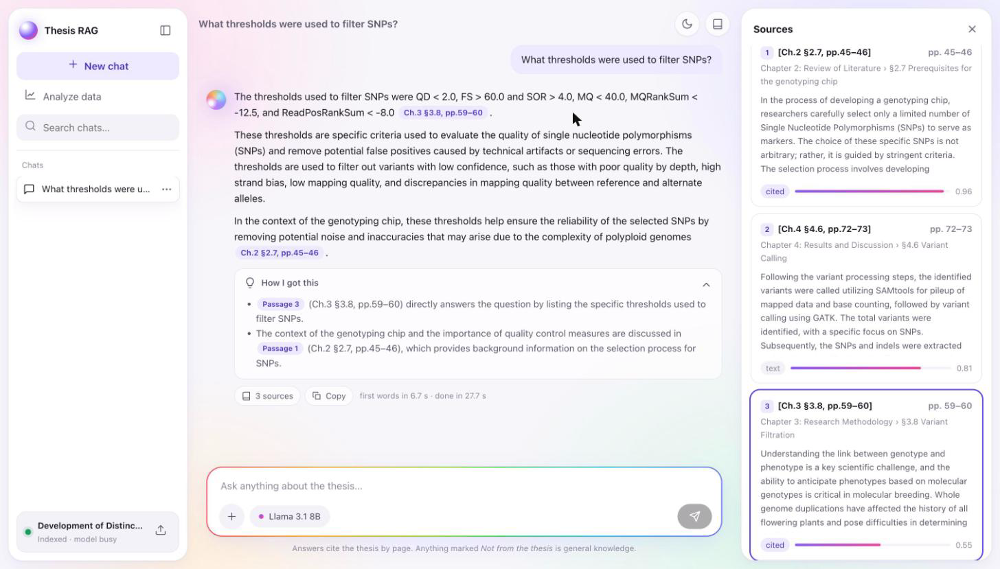
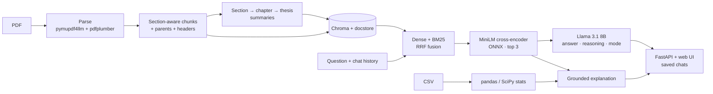

# Thesis RAG

Ask a PhD thesis questions in plain language and get answers that cite the
thesis by chapter, section and page, with the reasoning behind each answer.
Questions the thesis does not cover are still answered, from general
knowledge, and clearly labelled as such. Chats are saved, and you can upload
new data to see it explained against the thesis. Runs entirely on your
machine with Ollama (Llama 3.1 8B and nomic-embed-text).

**Live demo:** https://thesis-rag-magicpeach.fly.dev (hosted on Fly.io; the first visit after a quiet spell takes ~30-60 s to wake up)



> **The thesis PDF is not in this repository.** Put your own copy at
> `data/raw/thesis.pdf` (the `data/raw/` folder is git-ignored). Ingestion
> accepts any PDF path.

## Architecture



More detail in [docs/ARCHITECTURE.md](docs/ARCHITECTURE.md).

## Features

- **Answers you can check.** Every claim from the thesis is tagged like
  `[Ch.3 §3.8, pp.59–60]`; clicking a tag opens the passage. Each answer ends
  with a collapsible *How I got this* section saying which passages were used
  and how.
- **No dead ends.** If the thesis does not cover a question, the model answers
  from general knowledge under a *Not from the thesis* badge instead of
  refusing; background it adds to a thesis answer is tagged *general
  knowledge*. Greetings skip retrieval, and follow-ups ("why?", "explain
  that more simply") use the conversation so far.
- **Saved chats.** Every conversation is stored (SQLite) with its sources and
  reasoning; chats can be searched, renamed and deleted from the sidebar.
- **Structure-aware parsing.** Headings, chapters and numbered sections are
  recovered from the PDF; running headers, page numbers, the table of contents
  and the references are removed; tables are kept with their captions.
- **Section-aware chunking** (~600 tokens, 12% overlap) with a
  `Chapter › Section` header on every chunk, parent passages, and
  section → chapter → thesis summaries for broad questions.
- **Hybrid retrieval.** Dense and BM25 search fused with Reciprocal Rank
  Fusion and reranked by an ONNX cross-encoder.
- **Decision support for new data.** Upload a CSV: pandas and SciPy compute the
  statistics (group tests with Holm correction, effect sizes, correlations,
  and the thesis's own filtering thresholds), then the model explains them
  against the thesis, with citations and a limitations note.
- **Evaluation harness** comparing configurations on hit@k, MRR and LLM-judged
  faithfulness and relevance.
- **Web UI** with streaming answers, a stop button, light and dark themes,
  keyboard navigation, a phone layout, and no build step.

## Quick start

Requires Python 3.11+ and [Ollama](https://ollama.com).

```bash
# 1. Models
ollama pull llama3.1:8b
ollama pull nomic-embed-text

# 2. Install
python -m venv .venv && source .venv/bin/activate
pip install -e ".[dev]"

# 3. Index a PDF (cached: re-running with the same file and settings is instant)
python -m thesis_rag.ingest data/raw/thesis.pdf

# 4. Run the app, then open http://127.0.0.1:8000
uvicorn thesis_rag.api:app
```

Or from the terminal:

```bash
python -m thesis_rag.generate "Which tool was used for variant calling?"
python -m thesis_rag.analyze card                 # writes data/knowledge_card.json
python -m thesis_rag.analyze csv my_data.csv --group genotype
```

`examples/sample_variants.csv` is a small **synthetic** variant-QC table (QD, FS, SOR,
MQ by genotype) for trying the Analyze view; it is not data from the thesis.

The first ingestion of a ~100-page thesis makes one Llama call per section for
the summaries; expect anywhere from 15 minutes on a free machine to over an hour
on a busy one. Use `--no-summaries` to skip them. The reranker (~90 MB, ONNX) is
downloaded from Hugging Face on the first question.

### Docker

```bash
docker compose up --build        # Ollama + model pull + app on http://localhost:8000
```

On macOS, containers cannot use the GPU, so run Ollama natively and only the app
in Docker:

```bash
RAG_OLLAMA_BASE_URL=http://host.docker.internal:11434 docker compose up --build --no-deps app
```

### Deployment (Hugging Face Spaces)

The live demo is a free Docker Space. A free CPU host cannot run an 8B model,
so the demo uses the open-weight gpt-oss-20b through [Groq](https://groq.com) (Groq no longer serves Llama 3.1)
(`RAG_LLM_PROVIDER=groq`) and computes query embeddings with fastembed, whose
ONNX nomic-embed-text gives the same vectors as Ollama's. The prebuilt index
contains the thesis text, so it lives in a private dataset that the Space
downloads at startup; uploads are disabled on the demo.

```bash
hf auth login                       # write token
python deploy/huggingface/publish.py
# then add GROQ_API_KEY and HF_TOKEN (read) as Space secrets
```

## Speed

Measured on the development laptop (Apple Silicon, heavily loaded), local
Ollama:

| | Before | Now |
|---|---|---|
| Reranking 20 candidates | ~14 s (bge-reranker-base, PyTorch) | ~0.1–1 s (MiniLM, ONNX) |
| Prompt size | 5 parent sections, up to ~6k tokens | 3 passages, up to ~2k tokens |
| First words of the answer | 26–40 s | ~7–9 s |

The answer streams, so reading starts at the first words. Ollama keeps the
model loaded between questions (`keep_alive`), and the server warms the index,
reranker and model up at startup. On the hosted demo, Groq generates the whole
answer in about a second.

## API

| Method | Path | Purpose |
|---|---|---|
| `GET` | `/healthz` | Liveness |
| `GET` | `/status` | Document, index counts, ingest progress, model state |
| `POST` | `/ingest` | Upload a PDF (`file`) or name a server path (`path`); builds in the background |
| `POST` | `/ask` | `{"question", "chat_id"?}` → Server-Sent Events: `chat`, `mode`, `token`…, `reasoning`…, `answer` (with sources), `done` |
| `GET` | `/chats` | Saved chats for this browser (`?q=` searches titles) |
| `GET` / `PATCH` / `DELETE` | `/chats/{id}` | Open, rename (`{"title"}`) or delete a chat |
| `POST` | `/analyze` | CSV upload (`file`, optional `group_col`, `explain`) → statistics + explanation |

Chat endpoints are scoped by an `X-Client-Id` header, a random id each browser
generates, so visitors of a shared deployment never see each other's chats.
Interactive docs at `/docs` while the server runs.

## Configuration

Settings come from `config.yaml`, overridden by environment variables with the
`RAG_` prefix (`RAG_TOP_K=5`), overridden by code. `RAG_CONFIG` points at a
different YAML file.

| Setting | Default | Meaning |
|---|---|---|
| `llm_provider` | `ollama` | `ollama` locally, `groq` for the hosted demo |
| `embedding_provider` | `ollama` | `fastembed` runs nomic-embed-text as ONNX without Ollama |
| `ollama_base_url` | `http://localhost:11434` | Ollama server |
| `llm_model` / `groq_model` | `llama3.1:8b` / `llama-3.1-8b-instant` | Generation, summaries, judge |
| `embedding_model` | `nomic-embed-text` | Embeddings |
| `num_ctx` | `8192` | Context window for generation |
| `temperature` | `0.1` | Low: extraction, not creativity |
| `keep_alive` | `30m` | How long Ollama keeps the model loaded |
| `max_answer_tokens` | `600` | Cap on answer length |
| `chunk_size` / `chunk_overlap` | `600` / `72` | Child chunk tokens and overlap |
| `max_parent_tokens` | `1500` | Sibling sections merge into one parent up to this size |
| `retrieve_k` / `top_k` | `20` / `3` | Candidates per retriever / passages sent to the LLM |
| `rrf_k` | `60` | RRF constant |
| `use_bm25` | `true` | Hybrid search |
| `use_reranker` / `reranker_model` | `true` / `Xenova/ms-marco-MiniLM-L-6-v2` | Cross-encoder reranking (ONNX) |
| `use_multi_query` | `false` | LLM query rephrasings (`num_query_variants`) |
| `use_parent_context` / `max_passage_tokens` | `true` / `700` | Send parent sections up to this size, else the matched chunk |
| `allow_general_knowledge` | `true` | Answer off-thesis questions, labelled; `false` restores "Not found in the thesis." |
| `history_turns` | `2` | Previous exchanges sent with a follow-up |
| `summarize_sections` | `true` | Build hierarchical summaries at ingest |
| `allow_ingest` | `true` | `false` disables uploads (public demo) |
| `data_dir` | `data` | PDFs, index, caches, knowledge card, chats |

## Evaluation

Ten draft questions (generated from the thesis, not yet verified), five
configurations, each adding one change (run with the earlier bge reranker and
5 passages):

| Config | hit@5 | MRR@5 | Faithfulness | Relevance | Cited | Not found |
|---|---|---|---|---|---|---|
| v1 baseline (page chunks, dense) | 70% | 0.58 | 4.83 | 3.30 | 83% | 40% |
| + structured chunking | 80% | 0.65 | 4.78 | 4.50 | 78% | 10% |
| + BM25 + RRF | 90% | 0.72 | 4.89 | 4.50 | 78% | 10% |
| + bge reranker | 100% | 0.93 | 4.90 | 4.60 | 50% | 0% |
| + multi-query | 100% | 0.93 | 4.78 | 4.40 | 56% | 10% |

The current default swaps in the MiniLM reranker and sends 3 passages: on the
same questions every expected page is still in the top 3 (MRR 0.88), at a
fraction of the cost. Ten unverified questions and a self-judging 8B model
make these indicative, not conclusive. [docs/EVALUATION.md](docs/EVALUATION.md)
covers the method and caveats; `python eval/run_eval.py` reproduces it.

## Design decisions and tradeoffs

| Decision | Why | Cost |
|---|---|---|
| Markdown parsing instead of plain text | Headings drive section detection, chunk boundaries, headers and citations | PDF-specific rules (chapter overview pages, running headers) |
| Small chunks, large parents | Precise vectors for search, full context for the answer | Duplicate text in the docstore; budget logic for long parents |
| Contextual headers on chunks | Chunks match queries that only use words from their heading | Slightly noisier embeddings for very short chunks |
| Hierarchical summaries | Broad questions have nothing to retrieve otherwise; bottom-up fits an 8k context | One LLM call per section at ingest; summaries can be wrong, so they are routed only to broad questions and labelled in citations |
| Hybrid + RRF | Dense misses exact identifiers, BM25 misses paraphrases; RRF needs no score calibration | Two searches per query |
| MiniLM cross-encoder (ONNX) instead of bge | Same hits on the eval set, ~100x faster, no PyTorch | Slightly lower MRR (0.88 vs 0.93) |
| 3 passages instead of 5 | Prompt processing dominates local latency; all expected pages were in the top 3 | Less context for multi-part questions |
| General knowledge, labelled | Users get an answer instead of a dead end, and can still see what the thesis says | The model decides what is "covered"; a weak passage may be ignored |
| Reasoning section on every answer | Readers can check how an answer was reached | ~50 more tokens per answer |
| Copyable citation tags + normalisation | An 8B model formats citations unreliably; copying is easier than composing | Uncited answers still happen and are flagged, not fixed |
| SQLite chats scoped by a browser id | No server or login; a shared demo stays private per visitor | Not authentication; clearing browser storage loses access to old chats |
| Stats in pandas/SciPy, LLM only explains | LLMs are unreliable at arithmetic and inference | Only the tests implemented are available |
| Chroma + JSON docstore, BM25 in memory | Zero services to run; the corpus is one document | Not built for many large documents |
| Local models, Groq only for the demo | Privacy, no cost, works offline; the demo needs a model a free host can reach | The demo sends thesis passages to Groq |

## Limitations

- One document per index; ingesting a new PDF replaces the current one.
- Parsing rules were developed against one thesis layout. Other theses may need
  heading-rule tweaks; scanned PDFs without a text layer are not supported.
- Llama 3.1 8B sometimes omits citations and is a lenient judge of its own
  answers; general-knowledge answers are only as good as an 8B model's memory.
- Locally, answer speed depends heavily on the machine; the numbers above were
  measured with other heavy processes running.
- The evaluation set is small and not yet verified by the author.
- The CSV analysis assumes tidy data (one row per observation) and only runs the
  tests listed above.

## Future work

- Verified, hand-written evaluation questions, including unanswerable ones.
- A stronger or separate judge model, and a few-shot citation prompt.
- Multi-document collections with per-document filters.
- OCR fallback for scanned pages and figure captions as searchable chunks.
- Page-image previews of cited passages in the UI.

## Project layout

```
src/thesis_rag/   config, ingest, chunking, index, retrieve, generate, analyze, store, api
web/              index.html, app.js, styles.css (served by FastAPI)
eval/             questions.jsonl, run_eval.py, judge prompts, results.md
deploy/           Hugging Face Space: Dockerfile, card, publish script
tests/            pytest suite (Ollama, embedder and reranker are faked)
notebooks/        00_original_baseline.ipynb: the v1 notebook, kept for comparison
docs/             ARCHITECTURE.md, EVALUATION.md, screenshot.png
```
