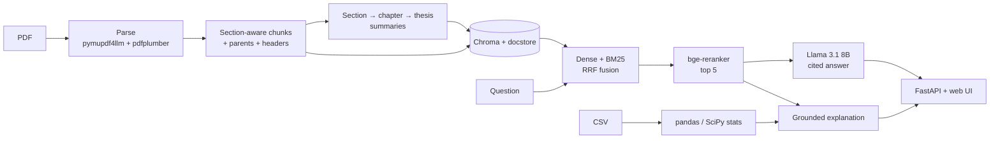

# Thesis RAG

Ask a PhD thesis questions and get answers with a page citation for every claim,
or upload new data and see it explained against the thesis. Runs entirely on
your machine with Ollama (Llama 3.1 8B and nomic-embed-text): no paid APIs, and
the document never leaves the laptop.

<!-- Replace with a real screenshot of the Ask tab: docs/screenshot.png -->


> **The thesis PDF is not in this repository.** Put your own copy at
> `data/raw/thesis.pdf` (the `data/raw/` folder is git-ignored). Ingestion
> accepts any PDF path.

## Architecture



More detail in [docs/ARCHITECTURE.md](docs/ARCHITECTURE.md).

## Features

- **Structure-aware parsing.** Headings, chapters and numbered sections are
  recovered from the PDF; running headers, page numbers, the table of contents
  and the references are removed; tables are extracted separately with their
  captions.
- **Section-aware chunking** (~600 tokens, 12% overlap) with a
  `Chapter › Section` header on every chunk, and parent passages so the model
  sees the whole section rather than a fragment.
- **Hierarchical summaries** (section → chapter → thesis) so broad questions
  like "what is the main contribution?" have something to retrieve.
- **Hybrid retrieval.** Dense and BM25 search fused with Reciprocal Rank
  Fusion, reranked by a cross-encoder. Optional multi-query expansion.
- **Cited answers.** Every claim is tagged like `[Ch.3 §3.8, pp.59–60]`; the
  model says "Not found in the thesis." instead of guessing.
- **Decision support for new data.** Upload a CSV: pandas and SciPy compute the
  statistics (group tests with Holm correction, effect sizes, correlations,
  and the thesis's own filtering thresholds), then the model explains them
  against the thesis, with citations and a limitations note.
- **Evaluation harness** comparing five configurations on hit@5, MRR and LLM-
  judged faithfulness and relevance.
- **Web UI** with streaming answers, citation chips that highlight their source
  passage, light and dark themes, keyboard navigation, and no build step.

## Quick start

Requires Python 3.11+ and [Ollama](https://ollama.com).

```bash
# 1. Models
ollama pull llama3.1:8b
ollama pull nomic-embed-text

# 2. Install
python -m venv .venv && source .venv/bin/activate
pip install -e ".[dev]"

# 3. Index a PDF (cached: re-running with the same file and settings is instant)
python -m thesis_rag.ingest data/raw/thesis.pdf

# 4. Run the app, then open http://127.0.0.1:8000
uvicorn thesis_rag.api:app
```

Or from the terminal:

```bash
python -m thesis_rag.generate "Which tool was used for variant calling?"
python -m thesis_rag.analyze card                 # writes data/knowledge_card.json
python -m thesis_rag.analyze csv my_data.csv --group genotype
```

`examples/sample_variants.csv` is a small **synthetic** variant-QC table (QD, FS, SOR,
MQ by genotype) for trying the Analyze tab; it is not data from the thesis.

The first ingestion of a ~100-page thesis makes one Llama call per section for
the summaries; expect anywhere from 15 minutes on a free machine to over an hour
on a busy one. Use `--no-summaries` to skip them. The reranker (~1 GB) is
downloaded from Hugging Face on the first question.

### Docker

```bash
docker compose up --build        # Ollama + model pull + app on http://localhost:8000
```

On macOS, containers cannot use the GPU, so run Ollama natively and only the app
in Docker:

```bash
RAG_OLLAMA_BASE_URL=http://host.docker.internal:11434 docker compose up --build --no-deps app
```

## API

| Method | Path | Purpose |
|---|---|---|
| `GET` | `/healthz` | Liveness |
| `GET` | `/status` | Document, index counts, ingest progress, Ollama reachability |
| `POST` | `/ingest` | Upload a PDF (`file`) or name a server path (`path`); builds in the background |
| `POST` | `/ask` | `{"question": "..."}` → Server-Sent Events: `token`…, `answer` (with sources), `done` |
| `POST` | `/analyze` | CSV upload (`file`, optional `group_col`, `explain`) → statistics + explanation |

Interactive docs at `/docs` while the server runs.

## Configuration

Settings come from `config.yaml`, overridden by environment variables with the
`RAG_` prefix (`RAG_TOP_K=8`), overridden by code. `RAG_CONFIG` points at a
different YAML file.

| Setting | Default | Meaning |
|---|---|---|
| `ollama_base_url` | `http://localhost:11434` | Ollama server |
| `llm_model` | `llama3.1:8b` | Generation, summaries, judge |
| `embedding_model` | `nomic-embed-text` | Embeddings |
| `num_ctx` | `8192` | Context window for generation |
| `temperature` | `0.1` | Low: extraction, not creativity |
| `chunk_size` / `chunk_overlap` | `600` / `72` | Child chunk tokens and overlap |
| `max_parent_tokens` | `1500` | Sibling sections merge into one parent up to this size |
| `retrieve_k` / `top_k` | `20` / `5` | Candidates per retriever / passages sent to the LLM |
| `rrf_k` | `60` | RRF constant |
| `use_bm25` | `true` | Hybrid search |
| `use_reranker` | `true` | Cross-encoder reranking |
| `reranker_model` | `BAAI/bge-reranker-base` | Reranker |
| `use_multi_query` | `false` | LLM query rephrasings (`num_query_variants`) |
| `use_parent_context` | `true` | Send parent sections instead of chunks |
| `max_passage_tokens` | `1200` | Longer parents are replaced by the matched chunk |
| `summarize_sections` | `true` | Build hierarchical summaries at ingest |
| `data_dir` | `data` | PDFs, index, caches, knowledge card |

## Evaluation

Ten draft questions (generated from the thesis, not yet verified), five
configurations, each adding one change:

| Config | hit@5 | MRR@5 | Faithfulness | Relevance | Cited | Not found |
|---|---|---|---|---|---|---|
| v1 baseline (page chunks, dense) | 70% | 0.58 | 4.83 | 3.30 | 83% | 40% |
| + structured chunking | 80% | 0.65 | 4.78 | 4.50 | 78% | 10% |
| + BM25 + RRF | 90% | 0.72 | 4.89 | 4.50 | 78% | 10% |
| **+ reranker (default)** | **100%** | **0.93** | 4.90 | 4.60 | 50% | 0% |
| + multi-query | 100% | 0.93 | 4.78 | 4.40 | 56% | 10% |

Retrieval improves at every step and the reranker is the biggest single gain.
Ten unverified questions and a self-judging 8B model make these indicative,
not conclusive. [docs/EVALUATION.md](docs/EVALUATION.md) covers the method and
caveats; `python eval/run_eval.py` reproduces it.

## Design decisions and tradeoffs

| Decision | Why | Cost |
|---|---|---|
| Markdown parsing instead of plain text | Headings drive section detection, chunk boundaries, headers and citations | PDF-specific rules (chapter overview pages, running headers) |
| Small chunks, large parents | Precise vectors for search, full context for the answer | Duplicate text in the docstore; budget logic for long parents |
| Contextual headers on chunks | Chunks match queries that only use words from their heading | Slightly noisier embeddings for very short chunks |
| Hierarchical summaries | Broad questions have nothing to retrieve otherwise; bottom-up fits an 8k context | One LLM call per section at ingest; summaries can be wrong, so they are routed only to broad questions and labelled as summaries in citations |
| Hybrid + RRF | Dense misses exact identifiers, BM25 misses paraphrases; RRF needs no score calibration | Two searches per query |
| Cross-encoder rerank of 20 | Biggest measured gain (MRR 0.72 → 0.93) | ~1 GB model and seconds of CPU per question |
| Multi-query off by default | No measured gain on the current questions | Available as a switch for paraphrase-heavy questions |
| Copyable citation tags + normalisation | An 8B model formats citations unreliably; copying is easier than composing | Uncited answers still happen and are flagged, not fixed |
| Stats in pandas/SciPy, LLM only explains | LLMs are unreliable at arithmetic and inference | Only the tests implemented are available |
| Chroma + JSON docstore, BM25 in memory | Zero services to run; the corpus is one document | Not built for many large documents |
| Local models only | Privacy, no cost, works offline | Slower and weaker than hosted models, especially as a judge |

## Limitations

- One document per index; ingesting a new PDF replaces the current one.
- Parsing rules were developed against one thesis layout. Other theses may need
  heading-rule tweaks; scanned PDFs without a text layer are not supported.
- Llama 3.1 8B sometimes omits citations (see the Cited column) and is a lenient
  judge of its own answers.
- The evaluation set is small and not yet verified by the author.
- The CSV analysis assumes tidy data (one row per observation) and only runs the
  tests listed above.

## Future work

- Verified, hand-written evaluation questions, including unanswerable ones.
- A stronger or separate judge model, and a few-shot citation prompt.
- Multi-document collections with per-document filters.
- OCR fallback for scanned pages and figure captions as searchable chunks.
- Page-image previews of cited passages in the UI.

## Project layout

```
src/thesis_rag/   config, ingest, chunking, index, retrieve, generate, analyze, api
web/              index.html, app.js, styles.css (served by FastAPI)
eval/             questions.jsonl, run_eval.py, judge prompts, results.md
tests/            pytest suite (Ollama, embedder and reranker are faked)
notebooks/        00_original_baseline.ipynb: the v1 notebook, kept for comparison
docs/             ARCHITECTURE.md, EVALUATION.md
```
