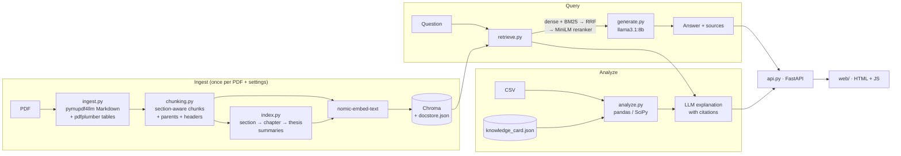

# Architecture

This document walks through the system from a PDF on disk to a cited answer in
the browser, and explains why each piece is built the way it is. The code is in
`src/thesis_rag/`; every module starts with a docstring covering the same
decisions in more detail.



## Modules

| Module | Responsibility |
|---|---|
| `config.py` | One typed `Settings` object: defaults < `config.yaml` < `RAG_*` env vars < keyword arguments |
| `ingest.py` | PDF → `ParsedDocument`: sections with chapter/number/title/pages, tables with captions |
| `chunking.py` | Sections → child chunks (for search) and parents (for the LLM), plus table and summary chunks |
| `index.py` | Build and load the persistent index: Chroma vectors, JSON docstore, BM25, caches, summaries |
| `retrieve.py` | Hybrid search, RRF fusion, optional multi-query, cross-encoder reranking, routing |
| `generate.py` | LLM client, summary prompts, answer prompt, citation tags and normalisation, `ThesisQA` |
| `analyze.py` | Knowledge card extraction; CSV statistics and their grounded explanation |
| `store.py` | Saved chats in SQLite, scoped per browser |
| `fetch_index.py` | Downloads the prebuilt index for the hosted demo |
| `api.py` | FastAPI endpoints and static hosting of `web/` |

## 1. Parsing (`ingest.py`)

**pymupdf4llm Markdown.** The original notebook used `PyPDFLoader`, which returns
plain text per page: headings, lists and tables all collapse into one stream.
pymupdf4llm emits Markdown, so headings survive as `##` lines, and those headings
are what everything downstream keys on. OCR is turned off: the thesis has a text
layer, and Tesseract on figure pages only produced noise.

**Cleaning.** Lines that repeat on at least 40% of pages (running headers and
footers) are removed, with digits masked so "Page 12" and "Page 13" count as the
same line. Lines that look like headings are never removed, because "CHAPTER 3"
also repeats across pages after masking. Page numbers and image placeholders
are dropped.

**Section detection.** Headings are classified as chapter (`CHAPTER 2`),
numbered (`2.5.1 ...`, whose first number must match the current chapter),
unnumbered all-caps (`ABSTRACT`) or inline (anything else, kept as text). Rules
that real theses need:

- A "chapter-wise explanation" page with several `Chapter N` headings is an
  overview, not a run of chapters.
- Chapter numbers must increase, so a later mention of "Chapter 2" in body text
  does not reset the structure.
- The references section and the table of contents and list pages are excluded:
  they match many queries lexically and answer none of them.

**Tables.** pymupdf4llm flattens tables into Markdown that loses their caption,
so tables are extracted separately with pdfplumber. A table must have at least
two rows and columns, mostly non-empty cells, and must not look like a table of
contents (a last column of page numbers). The caption is the nearest "Table N"
line above or below it; a caption-less table at the top of the next page with
the same column count is a continuation and is merged.

**Cache.** Parsing takes ~30 s, so its output is cached by the file's SHA-256.

## 2. Chunking (`chunking.py`)

**Small children for search, larger parents for the answer.** A ~600-token chunk
embeds one idea precisely, but the LLM answers better with the whole section.
Each child points to a parent; retrieval scores children and generation gets the
parent. Parents are leaf sections, merged with their siblings under the
two-level number (§2.5 = §2.5.1 … §2.5.11) when the group fits 1,500 tokens.
Many subsections in this thesis are 30 words long, and a 30-word passage wastes
one of the five context slots.

**Section-aware splitting.** Each section is split on its own, so a chunk never
spans two sections. Inside a section, LangChain's recursive splitter prefers
sub-headings, then paragraphs, lines and sentences; overlap is 72 tokens (12%).

**Contextual header.** Each chunk is embedded and BM25-indexed as
`Chapter 4: Results and Discussion › §4.3 Gapped Alignment` + body. A chunk
saying "the alignment rate was 87%" then also matches "gapped alignment
results", words that only appear in its heading.

**Metadata.** `chapter`, `section`, `section_title`, `page_start`, `page_end`,
`chunk_type` (`text`, `table` or `summary`) and `parent_id`. Pages come from
character offsets recorded during parsing, so a chunk that starts on page 40 and
ends on page 41 says so.

**Summaries.** Broad questions ("what is the main contribution?") have no single
answering passage. At ingest, Llama summarises each body section, then each
chapter from its section summaries, then the thesis from the chapter summaries
plus the abstract. They are built bottom-up because the whole thesis does not fit
an 8k context, but five chapter summaries do. Summaries are indexed as
`chunk_type=summary` and cached by a hash of their input, so re-chunking never
re-runs the LLM.

## 3. Index (`index.py`)

- **Chroma**, persistent, cosine space, with our own embeddings
  (`embedding_function=None`, so Chroma never downloads its default model).
- **docstore.json** is the source of truth for chunk text and metadata; Chroma
  stores only vectors, ids and two filterable fields.
- **BM25** (rank_bm25) is rebuilt from the docstore on load, which takes
  milliseconds; persisting it would be a second copy of the corpus to keep in
  sync. The tokenizer keeps identifiers such as `mi00022` and `3.10`.
- **nomic-embed-text prefixes.** The model was trained with `search_document:`
  and `search_query:` prefixes; leaving them out measurably hurts retrieval.
- **Idempotency.** A fingerprint of the PDF hash, the parser version and every
  setting that changes the index is stored in `manifest.json`, which is written
  last. Same fingerprint means nothing is rebuilt; an interrupted build has no
  manifest and is redone. Each chunking configuration has its own directory,
  so the baseline and structured indexes never mix.

## 4. Retrieval (`retrieve.py`)

```
question ─► [+ 3 LLM rephrasings]            (optional, off by default)
         ─► per query: dense top-20 + BM25 top-20
         ─► Reciprocal Rank Fusion ─► 20 candidates
         ─► MiniLM cross-encoder (ONNX) against the original question
         ─► best child per parent ─► top 3 passages
```

- **Hybrid.** Dense search matches meaning; BM25 matches exact tokens (tool
  names, gene IDs, "Table 3"). Each covers the other's misses.
- **RRF** fuses by rank: `score = Σ 1 / (60 + rank)`. BM25 scores are unbounded
  and cosine similarities sit in a narrow band, so adding raw scores would need
  per-corpus weights; ranks need none.
- **Cross-encoder reranking.** A bi-encoder embeds the question and passage
  separately; a cross-encoder reads them together and is far more accurate, but
  too slow for the whole corpus. Reranking 20 candidates is the usual compromise.
  In the evaluation it is the single biggest improvement (MRR 0.72 → 0.93 with
  bge-reranker-base). The default is now `ms-marco-MiniLM-L-6-v2` run as ONNX by
  fastembed: on the same questions it finds every expected page within the top
  3 (MRR 0.88) while reranking takes ~0.1–1 s instead of ~14 s, and it needs no
  PyTorch.
- **Routing.** A regex recognises broad questions ("main idea", "summarize",
  "overall contribution", "key findings", ...). Those also search summary chunks,
  and the whole-thesis summary is always passage 1. Specific questions search
  only original text and tables, so answers cite the thesis, not a summary of it.
- **Context budget.** Three passages, and parents longer than 700 tokens are
  replaced by the matching child. Locally, processing the prompt dominates the
  time to the first word, so a ~2k-token prompt instead of ~6k is the largest
  latency win after the reranker.

## 5. Generation (`generate.py`)

`ChatOllama(llama3.1:8b, temperature=0.1, num_ctx=8192, keep_alive=30m)`
locally, or the same model through Groq on the hosted demo. Every reply has
three parts:

1. **Mode.** If the passages answer the question, the model answers from them
   ("thesis"). If not, it writes `GENERAL:` first and answers from general
   knowledge without citations ("general"); the UI shows that as a *Not from the
   thesis* badge. A refusal ("Not found in the thesis.") was accurate but
   unhelpful for questions like "why do silkworms eat mulberry?"; labelling keeps
   both honesty and usefulness. Background added inside a thesis answer is
   tagged `(general knowledge)`. `allow_general_knowledge=false` restores the
   strict behaviour.
2. **Answer.** A direct first sentence, plain language, technical terms
   explained, and a citation tag at the end of every sentence taken from the
   thesis. Numbers must be quoted, never estimated.
3. **Reasoning.** 1–3 bullets saying which passages were used and what they
   say, or why the thesis does not cover the question, so a reader can check the
   answer rather than trust it.

Each passage is labelled `Passage 2 (cite as [Ch.3 §3.8, pp.59–60])`. Asking an
8B model to compose chapter, section and page itself fails often; copying a tag
is easy. Even so it makes predictable slips (`[Passage 2, Ch.3 …]`,
`(Passage 2)`, a copied placeholder), which `normalize_citations` repairs
before citations are counted and before the UI turns them into chips. Answers
it does not cite are flagged "No citation given" rather than given citations
after the fact.

**Conversation.** Greetings and thanks skip retrieval. A short follow-up with a
pronoun ("why is that?") is searched together with the previous question, and
the last two exchanges are sent with the prompt.

**Streaming.** `ThesisQA.ask_stream` runs the raw tokens through a
`StreamSplitter`, which holds back just enough text to recognise `GENERAL:` and
`Reasoning:` and emits `mode`, `token` and `reasoning` events, so the markers
never flash on screen. It finishes with an `Answer`: text, reasoning, mode,
sources, the passages actually cited and timings (including time to first
token).

## 6. Analysis (`analyze.py`)

**Knowledge card.** One prompt per field (objectives, methods, statistical
thresholds, traits, key findings), each over its own retrieved passages, in JSON
mode. Every item's citation is checked against the passages it was extracted
from (`citation_valid`), and the card is saved with `"reviewed": false` for a
person to check. Thresholds are structured (`parameter`, `operator`, `value`,
`action`) so they can be applied to data.

**CSV.** The LLM never does arithmetic. pandas and SciPy compute descriptive
statistics; per numeric column, a Welch t-test (two groups) or one-way ANOVA
(three or more) with Mann–Whitney or Kruskal–Wallis as a distribution-free check,
effect sizes (Cohen's d, η²), and Holm-adjusted p-values across columns; Pearson
correlations with |r| ≥ 0.3; and the knowledge card's thresholds applied to
columns with matching names (a `QD` column against "exclude if QD < 2.0"). Only
then does the LLM explain those numbers against retrieved thesis passages, with
citations, ending with a limitations paragraph. The response is labelled
decision support.

## 7. API and UI

FastAPI with lazily created heavy objects (index, reranker, LLM client), all
injectable through `create_app(...)` so tests run with fakes.

- `POST /ask` streams Server-Sent Events: `chat` (when a new chat was created),
  `mode`, `token` and `reasoning` events, then one `answer` event with the
  normalised text and sources, then `done`; failures after the stream started
  arrive as an `error` event. `EventSource` only supports GET, so the browser
  reads the stream with `fetch` (which also gives the UI a stop button through
  `AbortController`).
- **Saved chats.** `store.py` keeps chats and full answers in SQLite
  (`data/chats.db`). Each browser generates a random id once and sends it as
  `X-Client-Id`; every chat query is filtered by it, so visitors of a shared
  deployment never see each other's chats, without accounts. It is not
  authentication: anyone with the id could read those chats.
- **Warm-up.** At startup a background thread loads the index, the reranker and
  the model, so the first question does not pay for loading them.
- `POST /ingest` saves the upload and builds the index in a background thread;
  `GET /status` reports progress, the document, Ollama reachability and the
  active retrieval settings.
- `web/` is plain HTML, CSS and JavaScript with no build step: a sidebar of
  saved chats (search, rename, delete with an in-page confirmation), an empty
  state with suggestions, a composer with a stop button, answers with badges,
  chips and a collapsible reasoning panel, and a Sources drawer. All server text
  is inserted with `textContent`, never `innerHTML`, so text from the PDF or the
  model cannot inject markup.

## 8. Hosted demo (`deploy/huggingface/`)

A free Hugging Face Docker Space has two CPUs and no GPU, which cannot run an
8B model at a usable speed. So the demo keeps the pipeline and swaps two
providers:

- **Generation** through Groq (`llm_provider=groq`, `llama-3.1-8b-instant`, the
  same model family as local), which answers in about a second.
- **Query embeddings** through fastembed (`embedding_provider=fastembed`), an
  ONNX build of nomic-embed-text v1.5. Its vectors match Ollama's (cosine 1.0,
  identical top hits), so it can search the index built locally with Ollama.

The index contains the thesis text, so `publish.py` uploads it to a **private**
dataset and the Space downloads it at startup with a read token
(`thesis_rag.fetch_index`). Uploads are disabled (`allow_ingest=false`), so
visitors cannot replace the document.

## Failure handling

- Ollama calls during embedding and evaluation retry with backoff: under memory
  pressure Ollama sometimes fails to reload a model ("timed out waiting for
  llama-server to start").
- Multi-query expansion is an optimisation; if it fails the question is answered
  with the original query alone.
- A question with no retrieved passages is answered from general knowledge and
  labelled as such.
- On the hosted demo, a Groq rate limit is reported as "rate-limited, try again
  in a minute" rather than a stack trace.
